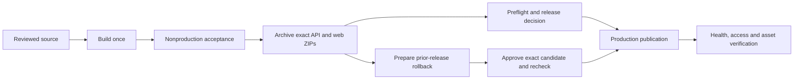
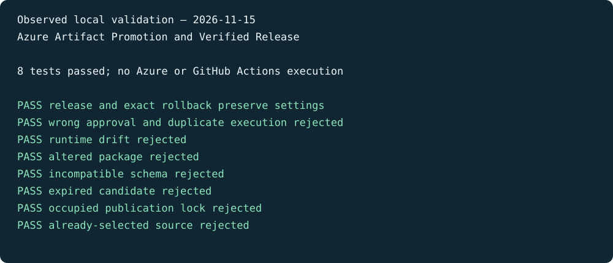

# Azure Artifact Promotion and Verified Release

**Build once, prove the package in nonproduction, and promote that same package to production.**

[The problem](#the-business-problem) · [The solution](#the-solution) · [What was built](#what-was-built) · [Step by step](#step-by-step) · [Proof](#proof-it-works) · [Workflow YAMLs](examples/workflows/README.md)

## The Business Problem

A workforce operations application supports onboarding, timesheets, screening documents and payroll work. Staff need releases that preserve those functions; rebuilding at production deployment can introduce different dependencies or files from the version they tested.

A failed release also needs more than an old source branch. Operators must have the actual previous packages, evidence showing where they came from, and a way to check whether those packages still work with the current database and settings.

The practical problem was to move tested software into production with a clear record of exactly what changed, preserve live settings and access boundaries, and prepare a deliberate recovery path without rebuilding an approximation of the old release.

## The Solution

Separate building from releasing. Keep the tested API and web ZIPs with source identities, SHA-256 fingerprints and acceptance receipts; promotion retrieves and verifies those files, checks the target, publishes without rebuilding and verifies the result.

**Business outcome:** Operators can explain which tested release is running and can evaluate a retained earlier release for recovery, while preserving existing application settings, schedules and delivery choices.

## What Was Built

This project explains an actual Azure platform release process through a complete fictional local model and clearly separated cloud integration templates. It adds no cloud resources and does not expose operational target names, identities, private records or credentials.

| Operational platform process | Public project material |
| --- | --- |
| Build API/web once and accept in nonproduction | Two fictional retained ZIP pairs with manifests |
| Verify selected source, archive and package hashes | Working local package verification |
| Review a fresh rollback candidate | Candidate hash, before-state, expiry and compatibility checks |
| Serialize publication and preserve settings | Exclusive local lock, stale-state rejection and settings readback |
| Publish exact packages through the existing publisher | Annotated release/rollback YAML integration templates |
| Verify live health, access, asset hashes and SQL contract | Cloud adapter requirements; **not claimed as local test coverage** |

The platform uses multiple workflows for candidate verification, archive, preflight, publication and rollback dispatch. The two examples condense those stages for teaching; the rollback example uses an in-process publisher instead of reproducing the platform's child-workflow dispatcher.

## System at a Glance



See [the architecture and identity paths](docs/ARCHITECTURE.md) for package, configuration, runner and database boundaries.

## Tools Used and What They Do

| Tool or service | Purpose in this process |
| --- | --- |
| GitHub Actions | Coordinate selected-source verification, publication and recovery; no deployment workflow is active in this public project. |
| GitHub CLI | Inspect trusted run identities and retrieve matching evidence. |
| SHA-256 and manifests | Identify exact package and candidate bytes; a hash is not authentication or permission. |
| Azure Blob Storage | Retain the actual built packages independently from short-lived preparation artifacts. |
| Entra OIDC federation | Give the workflow short-lived Azure access without a stored client secret. |
| Azure Functions and Static Web Apps | Host API and web packages; publish with remote/frontend build disabled. |
| Azure SQL | Supply live schema/runtime compatibility evidence before a rollback; no automatic schema downgrade. |
| Private release runner | Reach private dependencies when the selected readiness check requires it. |
| Python standard library | Run the local learning model and eight failure/success checks without cloud access. |

## Step by Step

Start with a blank folder and your own files. The [complete build guide](docs/BUILD-YOUR-OWN.md) includes every local Python file and both YAML examples so you can create an equivalent project without cloning this repository.

### 1. Create your own project folder

Create a new folder and the `lab` and `tests` subfolders. Use Python 3.10 or newer; the local model uses only its standard library.

```bash
mkdir my-artifact-promotion
cd my-artifact-promotion
mkdir lab tests
```

### 2. Write the local implementation and tests

Create `lab/__init__.py`, `lab/promotion.py` and `tests/test_promotion.py` from the full listings in the build guide. These are your own project files and operate only on fictional local ZIPs and JSON state.

### 3. Create a retained-package fixture

Initialize a new local `work` folder with two distinguishable API/web releases. This setup stands in for the earlier build/archive stages; it is not a command the real production publisher runs.

```bash
python -m lab.promotion setup
```

### 4. Prepare a release without publishing

Select the second fictional source and prepare a candidate file. The printed SHA-256 identifies the exact candidate you must review before the separate execution command.

```bash
python -m lab.promotion prepare --operation release --source 2222222222222222222222222222222222222222 --output release.candidate.json
python -m json.tool release.candidate.json
```

### 5. Select the reviewed release

Replace `YOUR_PRINTED_CANDIDATE_SHA256` with the hash printed by preparation and execute once. The model rechecks archive bytes and unchanged runtime state before updating the active pair; it does not rebuild either ZIP.

```bash
python -m lab.promotion execute --candidate release.candidate.json --approved-sha256 YOUR_PRINTED_CANDIDATE_SHA256
python -m json.tool work/runtime.json
```

### 6. Prepare and rehearse a rollback

Prepare the retained first release as a new rollback candidate and inspect it. Execute using its newly printed hash, then confirm the first source is active and the saved settings are preserved.

```bash
python -m lab.promotion prepare --operation rollback --source 1111111111111111111111111111111111111111 --output rollback.candidate.json
python -m json.tool rollback.candidate.json
python -m lab.promotion execute --candidate rollback.candidate.json --approved-sha256 YOUR_NEW_ROLLBACK_CANDIDATE_SHA256
python -m json.tool work/runtime.json
```

### 7. Prove meaningful failure cases

Run the test suite to check tampered packages, mismatched approval, expired candidates, state drift, schema conflict, an occupied publication lock and duplicate execution. All eight tests should pass because unsafe requests are rejected and the valid release/rollback path succeeds.

```bash
python -m unittest discover -s tests -v
```

### 8. Design your Azure integration separately

Use the [release YAML](examples/workflows/release.yml), [rollback YAML](examples/workflows/rollback.yml) and [adapter contract](examples/workflows/README.md) to map the same stages to your own Azure resources. Implement and test the target-specific adapter, OIDC scope, private runner, approval binding and real compatibility checks before activating either template.

### 9. Record evidence and close the lab

Keep the successful/denied results and explain why a retained artifact differs from rebuilt source. This local exercise creates no cloud resources; after inspecting your results, remove only the fictional folder and candidate files you created when you no longer need them.

## Proof It Works

[Local test results](docs/validation-results.txt) record eight passing checks from this implementation. They prove the model's decision behavior, not that an Azure release ran from these example workflows.



The real platform's accepted release process is the design source, while this public project contains fictional inputs and newly executed local tests. No production promotion, rollback, identity change, resource activation, message or GitHub Actions dispatch was performed to create this project.

## Strengths, Weaknesses and Tradeoffs

The process reduces differences between the tested package and the released package and makes recovery evidence inspectable. It adds archive storage, compatibility checks and operational work; keeping old files does not guarantee that an old release remains safe or compatible.

The local model is deliberately small and does not authenticate an operator or sign its manifests. See [operations and scaling](docs/OPERATIONS.md) for real approval, partial-publication, retention, concurrency and recovery considerations.

## Related Projects

- [Secure container delivery and rollback](https://github.com/truthofsource/secure-container-delivery-and-rollback): image packaging, signatures and retained-image selection.
- [Container lifecycle](https://github.com/truthofsource/azure-container-lifecycle): a worker image from build through deployment.
- [Platform operations and recovery](https://github.com/truthofsource/platform-operations-and-recovery): broader operational recovery boundaries.
