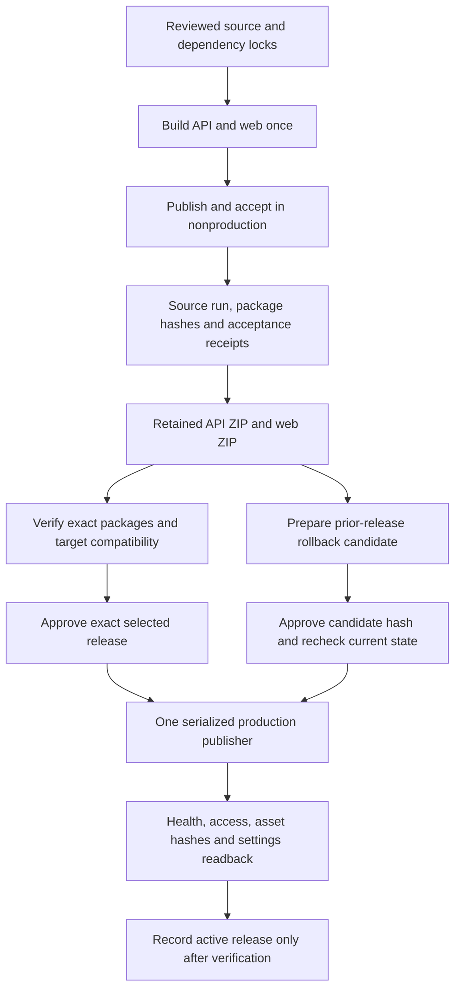

# Architecture and publication boundaries

The build and nonproduction stages produce evidence; promotion consumes it. No build command belongs in the production promotion stage.

## What is actually transferred

- **API:** the previously built ZIP and its source, file, migration-set and archive records.
- **Web:** the previously built frontend ZIP and asset hashes. The operational platform also writes a separately validated, production-owned runtime configuration overlay; this is an intentional environment configuration step, not a frontend rebuild or a claim that every deployed byte equals the ZIP.
- **Container workers:** a different publication boundary uses an immutable registry digest and verified signing evidence. Updating a job's image selection does not start that job; the container delivery project covers this separately.

A successful upload is not sufficient. Health and protected-route denial must pass, the selected assets must match, and settings/identities/schedules must remain within the approved change.

## Identity and network paths

GitHub Actions exchanges its OIDC token for short-lived Azure access through an exact repository/environment trust. The deployment identity has reviewed archive-read and publisher permissions; it is not the application's runtime identity. Static Web Apps publication uses the existing service deployment token obtained and masked by the publisher; using OIDC for Azure management does not remove that separate credential.

Read-only rollback preparation needs archive and current-binding access plus a path to query the private SQL contract. Use a deliberately provisioned private runner when required; a public hosted runner is not automatically able to reach private storage or SQL. This project creates no endpoints, firewall exceptions, runners or identities.

## Concurrency and failure

Release and rollback share a publication lock. In this sample rollback invokes the same adapter within its own locked workflow; the operational platform instead has a dispatcher call its existing publisher, so its parent must not hold the child's lock while waiting.

Two API/web cloud uploads are not a single database transaction. Record partial publication and verify both bindings after any failure; do not assume a failed run means nothing changed. The local model uses one atomic state-file replacement to demonstrate paired selection, not cloud-wide atomic deployment.

## Schema and configuration

A package rollback does not reverse migrations or restore data. The real process checks the live SQL ledger and runtime permissions against the older package's contract; the local model uses a deliberately small integer schema equality check. A mismatch requires a separate recovery decision, not an automated downgrade.
